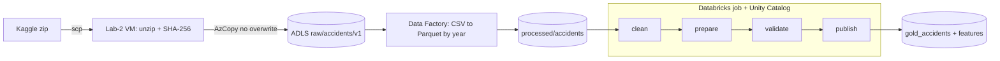
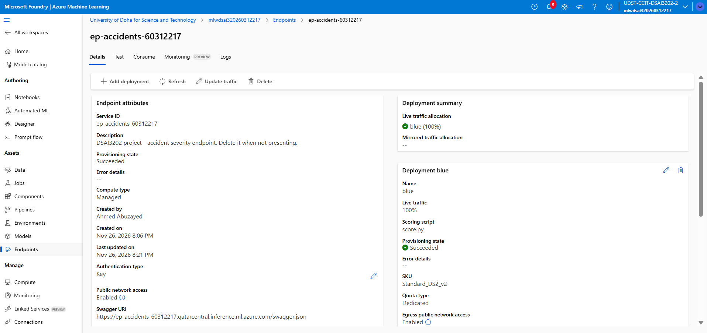

# Predicting severe US road accidents on Azure: Phases 1 and 2

DSAI3202 Cloud Computing, Fall 2026 · Ahmed Abuzayed (60312217) · individual project

# Project and hypothesis

- **Problem and user:** a traffic control center decides which newly reported accidents to handle first.
- **Target:** `label = 1` if `Severity` is 3 or 4 (big traffic impact), else 0. The prediction is made when the accident is reported, so only information known at that moment is used.
- **Hypothesis:** a model using time, weather and road information plus the county's earlier severe rate will find severe accidents better than two baselines on later, unseen years.
- **Baselines:** B1 always "not severe". B2 "severe" if the county's earlier severe rate is above the training average.
- **Metric and split:** recall and precision of the severe class (accuracy only for context, Lec-6). Train before 2022-01-01, test from 2022.
- **Approved changes:**

| Change | Original → revised | Reason |
| --- | --- | --- |
| Dataset | BTS flights (delay) → US-Accidents (severity) | BTS was taken by other students; instructor approved the new dataset by email |
| Bronze | Copy activity + data flow → one Mapping Data Flow | Same result in one activity |
| Job | prepare → validate → publish → **clean** added first | Whole chain runs in one job, in order |
| Features | Azure ML feature store → versioned Parquet snapshots + `FEATURES.md` | Feature store is optional in the brief |

# Dataset and architecture

- **Source:** US-Accidents (Moosavi et al.), https://www.kaggle.com/datasets/sobhanmoosavi/us-accidents, license CC BY-NC-SA 4.0. `archive.zip` 684,855,912 bytes → `US_Accidents_March23.csv` **3,058,183,727 bytes**, 7,728,394 rows, 46 columns.
- **Ingestion:** batch, one-off release. A new release would go to `raw/accidents/v2/`; `v1` is never overwritten.
- **Raw receipt:** `raw/accidents/v1/` in `amazonlake60312217`. Name, size and SHA-256: [source-manifest.json](ingestion/evidence/source-manifest.json), read-back check: [sha256-readback.txt](ingestion/evidence/sha256-readback.txt).
- **Repeat ingestion:** a second upload with `--overwrite=false` left name, size and ETag unchanged: [receipts-before.tsv](ingestion/evidence/receipts-before.tsv) = [receipts-after.tsv](ingestion/evidence/receipts-after.tsv).
- **Schema, keys, catalog and lineage:** [DATA_CONTRACT.md](DATA_CONTRACT.md). Unity Catalog tables: `dsai3202_databricks.s_60312217.silver_accidents` and `gold_accidents`.

**Storage layout:** `raw/accidents/v1/` (source) → `processed/accidents/accident_year=YYYY/` (bronze Parquet) → `processed/silver_accidents/` (silver Delta) → `curated/accidents_runs/<run_id>/gold` (accepted output) → `curated/accidents_runs/<run_id>/features` (feature snapshot). Evidence JSON: `curated/quality/accidents/`.



| Service | Role |
| --- | --- |
| Azure VM | download staging, hashing, AzCopy upload |
| ADLS Gen2 | raw, processed, curated zones and evidence |
| Data Factory | bronze: CSV → Parquet per `accident_year` (managed identity, trigger stopped) |
| Databricks + Unity Catalog | clean, quality gate, publish, features, EDA |

# Run the pipeline

1. **Versions:** latest commit on `main`. Databricks Runtime 18 LTS, ADF data flow Spark 3.5, VM tools `az`, `azcopy`, `python3`. Details: [environment.md](environment.md).
2. **Resources and access:** storage `amazonlake60312217` (raw, processed, curated), Lab-4 Data Factory (managed identity, Storage Blob Data Contributor), Databricks `dsai3202-databricks` with catalog `dsai3202_databricks`, schema `s_60312217`. No keys in Git: `az login`, managed identity and Unity Catalog are used.
3. **Ingestion:** copy `archive.zip` to the VM, then `bash ingestion/ingest.sh` (manifest → upload → read-back → repeat upload → receipt diff).
4. **Bronze:** import [adf/](adf/) and run `pl_transform_accidents` once (*Trigger now*).
5. **Job:** import the notebooks in [databricks/](databricks/), then create the job from [job-export.yml](databricks/job-export.yml) (*Edit as YAML*) or [job.json](databricks/job.json). Parameters: `lake`, `catalog`, `schema`, `run_id = {{job.run_id}}`, `test_bad_severity` (default `false`), `compare_to` (default empty).
6. **Run 1:** *Run now*. **Run 2 (same input):** `compare_to = <run 1 ID>`; publish compares gold and features with run 1 in both directions.
7. **Run 3 (invalid test input):** `test_bad_severity = true`, `compare_to = <run 1 ID>`. Prepare sets one `Severity` to 9 in this run's copy only. Expected: validate fails on `severity`, publish does not run. (Here the two values were set as job defaults for one run, then set back.)
8. **Verify:** `05_inspect` with the run ID (cells 3.1 + 4.1 / 5.1 / 6.1), then `06_eda`. Notebook exports with outputs: [databricks/exports/](databricks/exports/).

The large data stays in Azure; the instructor can be given read access to the storage account.

# Results and features

| Run | Run ID | Input version | Output | Result and evidence |
| --- | --- | --- | --- | --- |
| Bronze (ADF) | `0282f9e1-…caeff3` | raw v1 CSV | 8 year folders | 7,728,394 read = written ([output](adf/evidence/transform-run-0282f9e1-output.json)) |
| Success | `1100058089459956` | silver v4 | `accidents_runs/1100058089459956/`, gold v0 | gate passed ([job-runs.txt](databricks/evidence/job-runs.txt)) |
| Safe rerun | `317881341956481` | same saved input (silver v4) | gold v1 | **SAME CONTENT**: gold and features 7,728,394 = 7,728,394 |
| Controlled failure | `1000630630652706` | test copy with one Severity = 9 | none | failed rule `severity`, publish skipped; **BLOCKED SAFELY**: latest run and gold v1 unchanged ([screenshot](databricks/evidence/failed-run-1000630630652706-graph.jpg)) |

- **Row accounting:** clean 7,728,394 = 7,728,394 kept + 0 rejected. The disjoint reasons are `null_key`, `bad_severity`, `bad_time`, `bad_year`, `bad_location` and `duplicate`, all 0 ([clean output](databricks/evidence/clean-run-927bdb79.txt)). Gate: 7,728,394 silver = 7,728,394 gold + 0 quarantined. The source is well formed; the work was typing the text columns and proving that no row was lost.
- **Quality policy:**
  - **Stop rules:** schema, volume, keys, severity 1–4, time and year, location, unique ID.
  - **Quarantine:** `End_Time` missing or before `Start_Time`; the job fails above 0.5% (Lab-6 tolerance).
  - **Warning:** missing weather (173,459 rows).
- **EDA** (all 7,728,394 rows, no sample; [06_eda](databricks/06_eda.py), [full output](eda/eda-output.txt)):
  - **Imbalance:** 19.5% severe, so B1 has 80.5% accuracy and 0 recall.
  - **Change over time:** severe share falls from 36% (2018) to 6.9% (2022) and 2.9% (2023). Train is 24.1% severe, test 6.4%.
  - **Provider bias:** Source1 has 8.1% severe and Source2 33.9%; Source1 grows from 31% of rows (2016) to 100% (2023).
  - **Missing values:** precipitation 28.5%, wind speed 7.4%.
  - **Outliers (flagged, not deleted):** wind up to 1,087 mph, temperature −89 to 207 °F, pressure 0 inHg.
  - **Correlation with label:** strongest is the county's earlier severe rate (+0.39); crossing −0.11; weather below 0.05.
  - **Group losses:** retention is 100% for every severity and year.

   

- **Modeling readiness:** the label shift and provider mix mean results will be reported overall and per provider (also inside Source1 only). The threshold, the outlier caps and any imputation will be learned on training years only. The hypothesis and split stay as approved.

| Feature | Type | Definition / source | Available at prediction time? | Missing values |
| --- | --- | --- | --- | --- |
| start_hour, day_of_week, month | int | from `Start_Time` | yes | none |
| is_night | int | `Sunrise_Sunset` = Night | yes | kept null |
| Temperature_F, Visibility_mi, Wind_Speed_mph, Precipitation_in | double | nearest weather station | yes | kept null |
| weather_condition | string | `Weather_Condition` | yes | "Unknown" |
| junction, crossing, traffic_signal, stop | int | road flags | yes | none |
| county_prior_accidents, county_prior_severe_rate | bigint, double | strictly earlier accidents in the same State + County | yes (past only) | 0 = no history |
| label | int | Severity ≥ 3 | target only | none |

- **Saved feature version:** `curated/accidents_runs/1100058089459956/features/` (7,728,394 × 19), recorded in that run's `success.json`. Full spec: [FEATURES.md](FEATURES.md).
- **Leakage and split:** `End_Time`, `Distance_mi` and `Description` are known only after the accident and are excluded. The county history uses `rangeBetween(unboundedPreceding, -1)`, so only earlier accidents count. Time split before / from 2022; preprocessing is learned on training years only.

# Resource use and contributions

- **Cost / performance choice:** bronze stored as Parquet. ADF read 3.06 GB of CSV and wrote 0.79 GB of Parquet (3.9× smaller) in a 78.5 s data flow stage. Later reads scan typed Parquet instead of the CSV. Job run 1 took 15 m 26 s, about 9 min of it cluster start-up (clean 12 m 28 s cold vs 3 m 27 s warm).
- **Cleanup and restart:**
  - Terminate the Databricks compute (it also auto-terminates after 60 min).
  - The job has no schedule and the ADF trigger stays stopped.
  - Deallocate the VM.
  - Keep the storage account (raw, snapshots, evidence).
  - To restart, start the compute and run the job; every run writes to its own `run_id` folder.
- **Contributions:** individual project, all by Ahmed Abuzayed.
- **Reused code:**

| Lab file | Used in | Main changes |
| --- | --- | --- |
| Lab-3 ingestion steps | `ingestion/ingest.sh` | new source, `raw/accidents/v1/` |
| Lab-4 data flow | `adf/*.json` | `accident_year` folders, Parquet column renames |
| Lab-5 `01_silver.py` | `01_clean.py` | accident columns, key `ID`, new rules, job parameters |
| Lab-6 `00_common`–`04_inspect`, `job.json`, `FEATURES.md` | `00_common`, `02_prepare`–`05_inspect`, job, `FEATURES.md` | accident gate rules, `end_before_start` quarantine, `test_bad_severity`, accident features |

- **Problem fixed:** ADF run `2a47e12c` failed on Parquet-invalid names like `Distance(mi)`. A rename step fixed it (run `0282f9e1`).

# Model and evaluation

All Phase-2 code is in [azureml/](azureml/): Lab-8, Lab-9 and Lab-10 code adapted to this dataset (see *Reused code (Phase 2)*). Every result below comes from the files in [azureml/evidence/](azureml/evidence/).

**Baselines and candidates**

| | What it does | Why |
| --- | --- | --- |
| B1 | Always "not severe" (the training majority) | Hypothesis baseline; shows what accuracy alone hides |
| B2 | "Severe" if `county_prior_severe_rate` > the training severe rate (0.2639) | Hypothesis baseline; the strongest single feature (+0.39 with the label, Phase-1 EDA) |
| `logreg` | Logistic regression (Lab-8/9) | Simple and fast |
| `rf` | Random forest, 3,500 trees (Lab-9) | Stronger, but slow to answer one request |
| `mine` | Gradient boosting, `HistGradientBoostingClassifier` (Lab-9 menu) | Small trees that fix each other's errors |

- **Features (14):** `start_hour`, `day_of_week`, `month`, `is_night`, `Temperature_F`, `Visibility_mi`, `Wind_Speed_mph`, `Precipitation_in`, `junction`, `crossing`, `traffic_signal`, `stop`, `county_prior_accidents`, `county_prior_severe_rate`. All are known when the accident is reported ([FEATURES.md](FEATURES.md)). `weather_condition` is left out: it is text, and the Lab-10 scoring script takes numbers only.
- **Pipeline:** median imputer → standard scaler → model with a fixed threshold (`FixedThresholdClassifier`, Lab-9). The imputer and scaler are fitted on training rows only and are saved inside the model.
- **Search (Lab-9 sweep):** 3 models × `severe_weight` [1, 4] × threshold [0.5, 0.2] = 12 trials, ranked on validation balanced accuracy. Trials slower than **50 ms at p95** for one prediction are crossed out (the Lab-9 ceiling).
- **Sampling:** each trial trains on a fixed sample of **150,000** training rows (the first IDs by `sha256(seed:ID)`, seed 42), as in Lab-9. Validation is a fixed view of 22,500 rows. Limitation: the model sees 3.1% of the training rows.

**Split (time separation, as approved)**: [splits.json](azureml/evidence/splits.json)

| Part | Period | Rows | Used for |
| --- | --- | --- | --- |
| train | 2016 → 2021-06-27 | 4,863,142 | fitting (150,000 sampled) |
| validation | 2021-06-28 → 2021-12-31 (last ~15% of pre-2022 rows, whole days) | 856,167 | choosing model, weight, threshold |
| test | 2022 | 1,762,452 | one final comparison: model vs B1 vs B2 (fixed 20,000 rows) |
| deploy | 2023 | 246,633 | "unseen" rows sent to the endpoint |

The four parts add up to 7,728,394, the full table. Each part has a membership hash, and the whole split has `split_id` `0a86b55c…`, so it can be rebuilt and checked exactly.

**Leakage prevention**
- No after-the-accident columns (`End_Time`, `Distance_mi`, `Description`, Phase 1).
- County history uses strictly earlier accidents only.
- Preprocessing is fitted inside the Pipeline on training rows only.
- Choices use validation only. The test rows were scored once, after the choice (`evaluate_holdout.py`, which first checks the test membership hash).
- Outliers are kept as in Phase 1. No caps were fitted: tree models are not affected by extreme values; for logistic regression this is a limitation.

**Pilot (Lab-9, 2.3):** one real job with `mine` (weight 1, threshold 0.5): balanced accuracy 0.5549, training 1.9 s, 2.4 ms per accident at p95 ([pilot.json](azureml/evidence/pilot.json)).

**Model choice on validation**: sweep `upbeat_floor_tf3kt7bzl0`, 12 trials, 4 over the ceiling ([leaderboard.json](azureml/evidence/leaderboard.json))

| Trial | Model | Weight | Threshold | Val acc | Severe found | Precision | Bal acc | p95 ms | Ceiling |
| --- | --- | --- | --- | --- | --- | --- | --- | --- | --- |
| `_0` | logreg | 1 | 0.2 | 0.6998 | 0.6731 | 0.2153 | **0.6881** | 1.0 | ok |
| `_3` | logreg | 4 | 0.5 | 0.7041 | 0.6674 | 0.2170 | 0.6879 | 1.1 | ok |
| `_11` | rf 3500 trees | 4 | 0.5 | 0.7062 | 0.6389 | 0.2130 | 0.6766 | 329.9 | OVER |
| `_4` | mine | 1 | 0.2 | 0.7027 | 0.6245 | 0.2080 | 0.6684 | 2.2 | ok |
| `_9` | rf 3500 trees | 1 | 0.5 | 0.8830 | 0.1445 | 0.3874 | 0.5584 | 370.8 | OVER |

- **Chosen:** `upbeat_floor_tf3kt7bzl0_0`. "logreg, weight 1, threshold 0.2 led the trials under the ceiling at balanced accuracy 0.6881 and p95 1.0 ms against the 50 ms budget" ([chosen.txt](azureml/evidence/chosen.txt)).
- **Accuracy is misleading:** the accuracy winner (`_9`, 0.8830) is below always saying "not severe" (0.8920 on validation) and finds only 14% of severe accidents.
- **All four forest trials are too slow to serve** (330–378 ms). Gradient boosting came close (0.6684) but did not beat logistic regression.

**Final test: 2022, the same 20,000 untouched accidents for all three** (6.9% severe; [holdout.json](azureml/evidence/holdout.json))

| | Balanced acc. | Severe recall | Severe precision | Severe F1 | Accuracy |
| --- | --- | --- | --- | --- | --- |
| Chosen model (logreg, t=0.2) | 0.6491 | 0.5914 | 0.1298 | 0.2129 | 0.6987 |
| B1 always "not severe" | 0.5000 | 0.0000 | 0.0000 | 0.0000 | 0.9311 |
| B2 county rate > training rate | 0.6485 | 0.5849 | 0.1307 | 0.2137 | 0.7034 |

- **Representative errors:**
  - The 5 missed severe accidents all had good visibility (10 mi), and most came from counties with a low earlier severe rate (0.005–0.20). The model gave them P(severe) 0.04–0.17.
  - The 5 false alarms all came from counties with a high earlier severe rate (0.21–0.43).
  - So the model relies mostly on the county's history.
- **Error slice by provider (`Source`):**

| Source | Test rows | Severe share | Model recall | Model precision | B2 recall | B2 precision |
| --- | --- | --- | --- | --- | --- | --- |
| Source1 | 17,331 | 2.8% | 0.5389 | 0.0494 | 0.5471 | 0.0518 |
| Source2 | 2,457 | 34.0% | 0.6220 | 0.5746 | 0.6029 | 0.5311 |
| Source3 | 212 | 25.5% | 0.5926 | 0.6038 | 0.6481 | 0.5932 |

  Inside Source1, which is 87% of the 2022 test rows and all of 2023, precision falls to about 5%: 19 of every 20 flagged accidents are not severe. The model beats B2 only on Source2.
- **Hypothesis outcome: refuted.**
  - **The rule, fixed before the test:** supported if the model has higher severe recall than B1 *and* a higher severe F1 than B2 on the same test accidents.
  - **First part:** the model beats B1 (recall 0.5914 vs 0).
  - **Second part:** it does not beat B2 (F1 0.2129 vs 0.2137). Balanced accuracy is also practically equal (0.6491 vs 0.6485).
  - **Meaning:** on later years, time, weather and road information add almost nothing beyond the county's earlier severe rate.
- **Limitations:**
  - The severe share keeps falling (26.4% in the training rows, 6.9% in the 2022 test view, 3.05% in the 2023 sample), so a threshold chosen on older years flags too many accidents later.
  - Providers report severity differently, and the mix changes over time.
  - Training uses a 150,000-row sample.
  - `weather_condition` is not used.

# Traceability and deployment

| Item | Value |
| --- | --- |
| Data asset | `accidents-features:1`: retained copy of Phase-1 run `1100058089459956`, 7,728,394 rows ([data_source.json](azureml/evidence/data_source.json)) |
| Snapshot SHA-256 | `6292f6f7bf2bc8284f6c06408b0d6d18acff5e1533cae8ce13eb6b10bb16dd17` (folder `curated/p2_snapshots/<that hash>/features/`) |
| Feature version | `accidents_features_v1` ([FEATURES.md](FEATURES.md)) |
| Training environment | `accidents-env:1` ([conda.yml](azureml/train/conda.yml): Python 3.11.9, scikit-learn 1.5.2, MLflow 2.17.2) |
| Code commit | `9bcd1d3` (code at the time of the sweep) |
| Pilot / sweep / chosen run | `cool_reggae_zrggw71898` / `upbeat_floor_tf3kt7bzl0` / `upbeat_floor_tf3kt7bzl0_0` |
| Registered model | `accident-severity` version **1** (type `mlflow_model`), [model-v1.yml](azureml/train/model-v1.yml) |
| Deployed | endpoint `ep-accidents-60312217`, deployment `blue` (100% traffic), model `azureml:accident-severity:1`, environment `accidents-inference-env:1`, 1 × `Standard_DS2_v2` |



- **Why a retained copy:** `curated/accidents_features_v1/` is a "latest" folder that a new run would replace. `retain_data.py` (Lab-8) copies the run's 4 Parquet files to a folder named by their SHA-256 and writes one hash per file. Every job and check verifies these hashes first.
- **Model tags** (written by `model_yml.py` from the run itself):
  - `git_commit`, `training_run`, `sweep_run`, `data_asset`, `data_sha256`, `feature_set`, `features`
  - `split_id`, `test_membership_sha256`, `val_from_ts`, `test_from_ts`, `deploy_from_ts`, `train_severe_rate`
  - `model`, `hyperparameters`, `severe_weight`, `threshold`, `seed`, `sample_rows`, `sample_method`
  - validation metrics, `latency_p95_ms`, `limitations`
  - after the final test: `test_balanced_accuracy`, `test_recall_severe`, `test_precision_severe`, `test_f1_severe`
- **Lineage:** model version 1 → *Created by job* `upbeat_floor_tf3kt7bzl0_0` → sweep `upbeat_floor_tf3kt7bzl0` → `azureml:accidents-features:1` → `snapshot_sha256` = the model's `data_sha256` → the folder named with that hash. Loading by name and version only worked ([loaded.txt](azureml/evidence/loaded.txt)).

**Input contract** ([score.py](azureml/serve/score.py), from Lab-10)

- **Request:** `POST` to the scoring URI with header `Authorization: Bearer <key>` and body `{"data": [ {row}, ... ]}`.
  - Each row has the **14 computed features** above as numbers.
  - `null` is allowed and means "unknown"; the model fills it with the training median.
  - An optional `"id"` is returned in `"ids"`.
  - At most 1,000 rows per request.
- **Response:** `{"predictions": [0 or 1, ...], "probabilities": [P(severe), ...], "model": "accident-severity:1", "n": rows, "ids": [...]}`. 1 = severe (Severity 3 or 4).
- **Errors:** these requests get `{"error": "...", "expected_columns": [...]}`:
  - an empty body or invalid JSON
  - a missing `data` key
  - more than 1,000 rows
  - a missing column
  - text instead of a number

  A failure inside the model gets HTTP 424.
- **Raw records or features?** The endpoint takes **computed features**, not raw accident records. To build a row from a new accident:
  - `start_hour`, `day_of_week` (1 = Sunday … 7 = Saturday), `month`: from `Start_Time`.
  - `is_night`: 1 if `Sunrise_Sunset` is "Night", else 0.
  - The 4 weather values come from the nearest weather station at that time.
  - The 4 road flags are 0/1.
  - `county_prior_accidents` and `county_prior_severe_rate`: the count and severe share of strictly earlier accidents in the same State + County.
  - All of this is computed by `make_features()` in [databricks/00_common.py](databricks/00_common.py), the same code that built the training data. Example: [sample-request.json](azureml/checks/sample-request.json).

**Repeatable setup** (the lab VM, the same workspace as Labs 8–10)

```bash
# laptop: GitHub -> Code -> Download ZIP, then copy it as in the labs
cd ~/Lab-03-access
scp -o HostKeyAlgorithms=ssh-ed25519 -i ./dsai3202_lab3 "$HOME/Downloads/dsai3202-project-accidents-main.zip" azureuser@VM_PUBLIC_IP:~/
# VM
cd ~ && python3 -m zipfile -e dsai3202-project-accidents-main.zip .
cd ~/dsai3202-project-accidents-main/azureml
source ~/.config/dsai3202/lab3.env
az account show --query name -o tsv || az login --use-device-code
bash scripts/setup.sh && source .env                       # names, az defaults, MLflow URI
python3 train/retain_data.py $SA                           # retain the Phase-1 features
az ml data create -f train/data-asset.yml                  # accidents-features:1
az ml environment create -f train/environment.yml          # accidents-env:1
PILOT=$(az ml job create -f train/job.yml --set inputs.model=mine display_name=pilot-mine --query name -o tsv); echo $PILOT > .pilot
bash scripts/wait.sh $PILOT && python3 train/show_run.py
SWEEP=$(az ml job create -f train/sweep.yml --query name -o tsv); echo $SWEEP > .sweep
bash scripts/wait.sh $SWEEP
python3 train/leaderboard.py --sort val_balanced_accuracy  # best balanced accuracy under 50 ms
echo <run-id> > .chosen
python3 train/model_yml.py $(cat .chosen) $VERSION --commit <git-commit>
az ml model create -f train/model-v$VERSION.yml
python3 train/load_model.py accident-severity $VERSION
python3 train/evaluate_holdout.py                          # once
az ml environment create -f deploy/inference-env.yml       # accidents-inference-env:1
az ml online-endpoint create -f deploy/endpoint.yml --name $EP
az ml online-deployment create -f deploy/blue.yml --endpoint-name $EP --all-traffic
```

- **Access for the instructor:** the scoring URI is `https://ep-accidents-60312217.qatarcentral.inference.ml.azure.com/score` while the endpoint is up. The key is shared privately, never in the repo. Test call:
  `curl -X POST "$SCORING_URI" -H "Authorization: Bearer $KEY" -H "Content-Type: application/json" --data-binary @checks/sample-request.json`
- **Redeploy** (before the D2L window and the presentation): run the last three commands again. The model, data and environments stay registered. Then repeat `check_deployment.py` and `same_input_check.py`.
- **Cleanup:** `bash scripts/cleanup.sh` deletes the endpoint and its deployment, then checks that no endpoint and no compute target are left. Jobs ran on serverless compute, so nothing else bills. Stop the VM in the portal.

# Verification and resource use

| Check | Command | Result | Evidence |
| --- | --- | --- | --- |
| Valid and invalid inputs | `python3 checks/check_deployment.py` | 6 of 6 PASS | [functional_blue.json](azureml/evidence/functional_blue.json) (inputs, outputs, model version) |
| Offline vs deployed | `python3 checks/same_input_check.py` | **SAME**: 200 of 200 matched by ID, largest difference 0.00005, 200 of 200 labels agree | [same_input_blue.json](azureml/evidence/same_input_blue.json), [rows sent](azureml/evidence/same_input_blue_rows.json) |
| Unseen 2023 accidents | `python3 checks/score_unseen.py` | 2,000 scored, 0 failed; balanced accuracy 0.6313, severe found 0.5246, precision 0.0593 | [unseen.json](azureml/evidence/unseen.json) |
| Client latency | `python3 checks/latency_check.py --n 100 --target-ms 1000` | 100 of 100 OK; p50 29.26 ms, **p95 34.07 ms**; target met | [latency.json](azureml/evidence/latency.json), [requests](azureml/evidence/latency_requests.jsonl) |

- **Functional:**
  - The 2 valid requests (1 row, and 2 rows where one has a null) returned predictions from `accident-severity:1`.
  - The 4 invalid requests returned an `error`, not a crash, from the numbered checks in `score.py`:

  | Request | Answer | Check |
  | --- | --- | --- |
  | `empty` | "empty body" | 1 |
  | `too-long` | "too many rows: 1200" | 3 |
  | `missing-field` | "missing field(s): county_prior_severe_rate" | 4 |
  | `wrong-type` | "start_hour got 'morning'; Precipitation_in got 'rain'" | 5 |
- **Consistency:** 200 fixed 2022 accidents (chosen by a hash of `ID`; 8 of them have a null value) were scored by the registered model on the VM and by the endpoint, then matched **by ID**. Tolerance: probabilities within **0.00005** (`score.py` rounds to 4 decimals), and all labels equal.
- **Unseen 2023:** rows from 2023-01-02 on, strictly after the day the deploy slice starts (241,785 accidents; 2,000 sampled with seed 42).
  - Balanced accuracy and recall stay close to the 2022 test.
  - Precision drops to 5.9%, because only 3.05% of these accidents are severe and 2023 is Source1 only. This is the label shift Phase 1 found.
- **Performance target:** p95 ≤ **1,000 ms** client-observed for one accident per request (Lab-10 target), measured over 100 requests from the VM: **34.07 ms**. Model-only time was limited to 50 ms p95 when choosing (Lab-9): the chosen model takes 1.0 ms, and inside the container one request took 14.7 ms.
- **Cost / performance choice:**
  - The sweep trains on a 150,000-row sample, and the 50 ms ceiling removed the 3,500-tree forest (330–378 ms).
  - The chosen model answers in about 1 ms, so the endpoint runs on one small `Standard_DS2_v2` instance at $0.137 an hour in Qatar Central (Lab-10 price), about $3.29 a day.
  - So the endpoint stays up only for testing, the D2L window and the presentation. It ran for about 35 minutes for the checks above, then was deleted and can be redeployed from the registered model.
- **Cleanup procedure:**
  - `bash scripts/cleanup.sh` ended with "ep-accidents-60312217 gone; model, data and environments kept", with no endpoints and no compute targets left. Then the VM is stopped.
  - **Kept:** workspace, data asset, environments, registered model.

**Reused code (Phase 2)**

| Lab file | Used in | Main changes |
| --- | --- | --- |
| Lab-8 `retain_data.py`, `data-asset.yml`, `environment.yml`, `conda.yml` | `azureml/train/` | Phase-1 run as the source; new names |
| Lab-8/9 `ml_contract.py` | `train/ml_contract.py` | key `ID`; fixed-date split (test 2022, deploy 2023); severe = positive class |
| Lab-9 `train.py`, `job.yml`, `sweep.yml` | `train/` | 14 accident features; `severe_weight`; gradient boosting as `mine`; threshold 0.2 instead of 0.8 |
| Lab-9 `leaderboard.py`, `show_run.py`, `model_yml.py`, `load_model.py`, `aml_common.py`, `wait.sh` | `train/`, `scripts/` | severe metrics; extra tags (commit, limitations, sampling) |
| Lab-9 `evaluate_holdout.py` | `train/evaluate_holdout.py` | one run; B1 and B2; 20,000 test rows; errors and provider slice |
| Lab-10 `score.py`, deploy YAMLs, inference conda | `serve/`, `deploy/` | 14 columns; null accepted as unknown |
| Lab-10 `check_deployment.py`, `same_input_check.py`, `score_unseen.py`, `traffic_check.py`, `cleanup.sh` | `checks/`, `scripts/` | match by `ID`; read one year only; inputs and outputs saved; latency mode only |

- **Not used from the labs:** version 2 and green, the traffic split and the web app. The brief needs one model and one endpoint.
- **Problems fixed:**
  - `show_run.py` failed with `No module named 'leaderboard'` because that helper was not yet in the repo; adding `leaderboard.py` fixed it (the pilot did not need to rerun).
  - The first blue test failed because the deployment step was skipped; creating blue fixed it.
  - The `adlfs` traceback printed at the end of some scripts appears while Python closes the connection on exit, after the files are written.
- **Contributions:** individual project, all by Ahmed Abuzayed.

# AI use

| Tool | Request | Response | My changes and checks |
| --- | --- | --- | --- |
| Claude (Anthropic) | Explain the Phase 1 brief and help me plan each task from Labs 3–7. | Created a structured task plan and checklist while keeping the required lab order. | I reviewed and approved each step. |
| Claude | Tidy and improve the README page. | Helped me organize the content and present it in a clean, clear, and professional style. | Updated and reviewed the README documentation. |
| Claude | Generate a workflow diagram for the project. | Helped me create a diagram showing the data flow through ingestion, Azure Data Factory, Databricks processing, job execution, and analysis. | Reviewed and included the generated workflow diagram in the project documentation. |
| Claude | Review the code that I provided, check that the code was correct| Reviewed the provided code, suggested corrections, and helped resolve errors in the listed files: `ingest.sh`, the ADF data flow JSON, `01_clean`, `00_common`, `02_prepare`, `03_validate`, `04_publish`, `05_inspect`, `06_eda`, and the job definition. | I ran the ingestion script on my VM and built the ADF pipeline in the portal. When the ADF Parquet column-name error occurred, I reported it back, and it was fixed by adding a rename step. |
| Claude | Phase 2: plan the work from the brief, Lecture 8 and Labs 8–10 | A plan mapping each brief requirement to a lab step | I approved the plan and the choices (drop `weather_condition`, rank on balanced accuracy, one endpoint only) |
| Claude | Phase 2: Help me understand how to adapt the Lab-8/9/10 examples to my dataset, features, split and baselines | The files in `azureml/` (train, deploy, serve, checks, scripts) | I worked on the implementation, ran the steps myself on my VM and in Azure ML, checked the outputs and reported errors when they occurred |
| Claude | Phase 2: Help me improve the README wording and formatting| Suggested wording and presentation improvements to make the documentation clearer and more professional | Reviewed and approved the final content |


