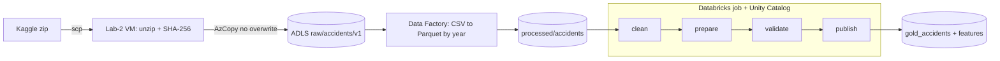
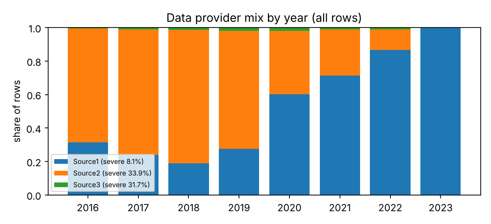

# Predicting severe US road accidents on Azure: Phase 1

DSAI3202 Cloud Computing, Fall 2026 · Ahmed Abuzayed (60312217) · individual project

# Project and hypothesis

- **Problem and user:** a traffic control center decides which newly reported accidents to handle first.
- **Target:** `label = 1` if `Severity` is 3 or 4 (big traffic impact), else 0. The prediction is made when the accident is reported, so only information known at that moment is used.
- **Hypothesis:** a model using time, weather and road information plus the county's earlier severe rate will find severe accidents better than two baselines on later, unseen years.
- **Baselines:** B1 always "not severe". B2 "severe" if the county's earlier severe rate is above the training average.
- **Metric and split:** recall and precision of the severe class (accuracy only for context, Lec-6). Train before 2022-01-01, test from 2022.
- **Approved changes:**

| Change | Original → revised | Reason |
| --- | --- | --- |
| Dataset | BTS flights (delay) → US-Accidents (severity) | BTS was taken by other students; instructor approved the new dataset by email |
| Bronze | Copy activity + data flow → one Mapping Data Flow | Same result in one activity |
| Job | prepare → validate → publish → **clean** added first | Whole chain runs in one job, in order |
| Features | Azure ML feature store → versioned Parquet snapshots + `FEATURES.md` | Feature store is optional in the brief |

# Dataset and architecture

- **Source:** US-Accidents (Moosavi et al.), https://www.kaggle.com/datasets/sobhanmoosavi/us-accidents, license CC BY-NC-SA 4.0. `archive.zip` 684,855,912 bytes → `US_Accidents_March23.csv` **3,058,183,727 bytes**, 7,728,394 rows, 46 columns.
- **Ingestion:** batch, one-off release. A new release would go to `raw/accidents/v2/`; `v1` is never overwritten.
- **Raw receipt:** `raw/accidents/v1/` in `amazonlake60312217`. Name, size and SHA-256: [source-manifest.json](ingestion/evidence/source-manifest.json), read-back check: [sha256-readback.txt](ingestion/evidence/sha256-readback.txt).
- **Repeat ingestion:** a second upload with `--overwrite=false` left name, size and ETag unchanged: [receipts-before.tsv](ingestion/evidence/receipts-before.tsv) = [receipts-after.tsv](ingestion/evidence/receipts-after.tsv).
- **Schema, keys, catalog and lineage:** [DATA_CONTRACT.md](DATA_CONTRACT.md). Unity Catalog tables: `dsai3202_databricks.s_60312217.silver_accidents` and `gold_accidents`.

**Storage layout:** `raw/accidents/v1/` (source) → `processed/accidents/accident_year=YYYY/` (bronze Parquet) → `processed/silver_accidents/` (silver Delta) → `curated/accidents_runs/<run_id>/gold` (accepted output) → `curated/accidents_runs/<run_id>/features` (feature snapshot). Evidence JSON: `curated/quality/accidents/`.

| Service | Role |
| --- | --- |
| Azure VM | download staging, hashing, AzCopy upload |
| ADLS Gen2 | raw, processed, curated zones and evidence |
| Data Factory | bronze: CSV → Parquet per `accident_year` (managed identity, trigger stopped) |
| Databricks + Unity Catalog | clean, quality gate, publish, features, EDA |

# Run the pipeline

1. **Versions:** latest commit on `main`. Databricks Runtime 18 LTS, ADF data flow Spark 3.5, VM tools `az`, `azcopy`, `python3`. Details: [environment.md](environment.md).
2. **Resources and access:** storage `amazonlake60312217` (raw, processed, curated), Lab-4 Data Factory (managed identity, Storage Blob Data Contributor), Databricks `dsai3202-databricks` with catalog `dsai3202_databricks`, schema `s_60312217`. No keys in Git: `az login`, managed identity and Unity Catalog are used.
3. **Ingestion:** copy `archive.zip` to the VM, then `bash ingestion/ingest.sh` (manifest → upload → read-back → repeat upload → receipt diff).
4. **Bronze:** import [adf/](adf/) and run `pl_transform_accidents` once (*Trigger now*).
5. **Job:** import the notebooks in [databricks/](databricks/), then create the job from [job-export.yml](databricks/job-export.yml) (*Edit as YAML*) or [job.json](databricks/job.json). Parameters: `lake`, `catalog`, `schema`, `run_id = {{job.run_id}}`, `test_bad_severity` (default `false`), `compare_to` (default empty).
6. **Run 1:** *Run now*. **Run 2 (same input):** `compare_to = <run 1 ID>`; publish compares gold and features with run 1 in both directions.
7. **Run 3 (invalid test input):** `test_bad_severity = true`, `compare_to = <run 1 ID>`. Prepare sets one `Severity` to 9 in this run's copy only. Expected: validate fails on `severity`, publish does not run. (Here the two values were set as job defaults for one run, then set back.)
8. **Verify:** `05_inspect` with the run ID (cells 3.1 + 4.1 / 5.1 / 6.1), then `06_eda`. Notebook exports with outputs: [databricks/exports/](databricks/exports/).

The large data stays in Azure; the instructor can be given read access to the storage account.

# Results and features

| Run | Run ID | Input version | Output | Result and evidence |
| --- | --- | --- | --- | --- |
| Bronze (ADF) | `0282f9e1-…caeff3` | raw v1 CSV | 8 year folders | 7,728,394 read = written ([output](adf/evidence/transform-run-0282f9e1-output.json)) |
| Success | `1100058089459956` | silver v4 | `accidents_runs/1100058089459956/`, gold v0 | gate passed ([job-runs.txt](databricks/evidence/job-runs.txt)) |
| Safe rerun | `317881341956481` | same saved input (silver v4) | gold v1 | **SAME CONTENT**: gold and features 7,728,394 = 7,728,394 |
| Controlled failure | `1000630630652706` | test copy with one Severity = 9 | none | failed rule `severity`, publish skipped; **BLOCKED SAFELY**: latest run and gold v1 unchanged ([screenshot](databricks/evidence/failed-run-1000630630652706-graph.jpg)) |

- **Row accounting:** clean 7,728,394 = 7,728,394 kept + 0 rejected. The disjoint reasons are `null_key`, `bad_severity`, `bad_time`, `bad_year`, `bad_location` and `duplicate`, all 0 ([clean output](databricks/evidence/clean-run-927bdb79.txt)). Gate: 7,728,394 silver = 7,728,394 gold + 0 quarantined. The source is well formed; the work was typing the text columns and proving that no row was lost.
- **Quality policy:**
  - **Stop rules:** schema, volume, keys, severity 1–4, time and year, location, unique ID.
  - **Quarantine:** `End_Time` missing or before `Start_Time`; the job fails above 0.5% (Lab-6 tolerance).
  - **Warning:** missing weather (173,459 rows).
- **EDA** (all 7,728,394 rows, no sample; [06_eda](databricks/06_eda.py), [full output](eda/eda-output.txt)):
  - **Imbalance:** 19.5% severe, so B1 has 80.5% accuracy and 0 recall.
  - **Change over time:** severe share falls from 36% (2018) to 6.9% (2022) and 2.9% (2023). Train is 24.1% severe, test 6.4%.
  - **Provider bias:** Source1 has 8.1% severe and Source2 33.9%; Source1 grows from 31% of rows (2016) to 100% (2023).
  - **Missing values:** precipitation 28.5%, wind speed 7.4%.
  - **Outliers (flagged, not deleted):** wind up to 1,087 mph, temperature −89 to 207 °F, pressure 0 inHg.
  - **Correlation with label:** strongest is the county's earlier severe rate (+0.39); crossing −0.11; weather below 0.05.
  - **Group losses:** retention is 100% for every severity and year.

   

- **Modeling readiness:** the label shift and provider mix mean results will be reported overall and per provider (also inside Source1 only). The threshold, the outlier caps and any imputation will be learned on training years only. The hypothesis and split stay as approved.

| Feature | Type | Definition / source | Available at prediction time? | Missing values |
| --- | --- | --- | --- | --- |
| start_hour, day_of_week, month | int | from `Start_Time` | yes | none |
| is_night | int | `Sunrise_Sunset` = Night | yes | kept null |
| Temperature_F, Visibility_mi, Wind_Speed_mph, Precipitation_in | double | nearest weather station | yes | kept null |
| weather_condition | string | `Weather_Condition` | yes | "Unknown" |
| junction, crossing, traffic_signal, stop | int | road flags | yes | none |
| county_prior_accidents, county_prior_severe_rate | bigint, double | strictly earlier accidents in the same State + County | yes (past only) | 0 = no history |
| label | int | Severity ≥ 3 | target only | none |

- **Saved feature version:** `curated/accidents_runs/1100058089459956/features/` (7,728,394 × 19), recorded in that run's `success.json`. Full spec: [FEATURES.md](FEATURES.md).
- **Leakage and split:** `End_Time`, `Distance_mi` and `Description` are known only after the accident and are excluded. The county history uses `rangeBetween(unboundedPreceding, -1)`, so only earlier accidents count. Time split before / from 2022; preprocessing is learned on training years only.

# Resource use and contributions

- **Cost / performance choice:** bronze stored as Parquet. ADF read 3.06 GB of CSV and wrote 0.79 GB of Parquet (3.9× smaller) in a 78.5 s data flow stage. Later reads scan typed Parquet instead of the CSV. Job run 1 took 15 m 26 s, about 9 min of it cluster start-up (clean 12 m 28 s cold vs 3 m 27 s warm).
- **Cleanup and restart:**
  - Terminate the Databricks compute (it also auto-terminates after 60 min).
  - The job has no schedule and the ADF trigger stays stopped.
  - Deallocate the VM.
  - Keep the storage account (raw, snapshots, evidence).
  - To restart, start the compute and run the job; every run writes to its own `run_id` folder.
- **Contributions:** individual project, all by Ahmed Abuzayed.
- **Reused code:**

| Lab file | Used in | Main changes |
| --- | --- | --- |
| Lab-3 ingestion steps | `ingestion/ingest.sh` | new source, `raw/accidents/v1/` |
| Lab-4 data flow | `adf/*.json` | `accident_year` folders, Parquet column renames |
| Lab-5 `01_silver.py` | `01_clean.py` | accident columns, key `ID`, new rules, job parameters |
| Lab-6 `00_common`–`04_inspect`, `job.json`, `FEATURES.md` | `00_common`, `02_prepare`–`05_inspect`, job, `FEATURES.md` | accident gate rules, `end_before_start` quarantine, `test_bad_severity`, accident features |

- **Problem fixed:** ADF run `2a47e12c` failed on Parquet-invalid names like `Distance(mi)`. A rename step fixed it (run `0282f9e1`).

# AI use

| Tool | Request | Response | My changes and checks |
|---|---|---|---|
| Claude (Anthropic) | Explain the Phase 1 brief and help me plan each task from Labs 3–7. | Created a structured task plan and checklist while keeping the required lab order. | I reviewed and approved each step. |
| Claude | Tidy and improve the README page. | Helped me organize the content and present it in a clean, clear, and professional style. | Updated and reviewed the README documentation. |
| Claude | Generate a workflow diagram for the project. | Helped me create a diagram showing the data flow through ingestion, Azure Data Factory, Databricks processing, job execution, and analysis. | Reviewed and included the generated workflow diagram in the project documentation. |

