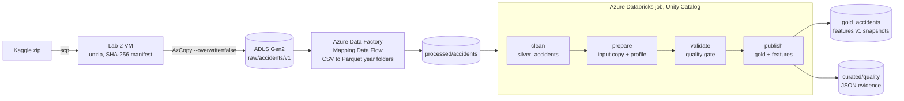
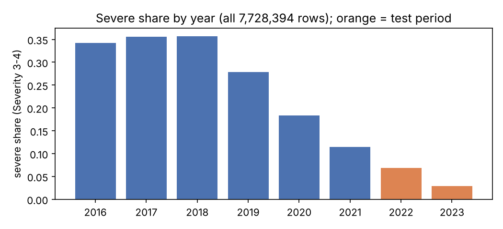

# Predicting severe US road accidents on Azure: Phase 1 (data pipeline, ETL and features)

DSAI3202 Cloud Computing, Fall 2026 · Ahmed Abuzayed (60312217) · individual project

# Project and hypothesis

- **Problem and user:** a traffic control center decides which newly reported accidents to handle first (police, tow trucks, road-sign warnings, other routes).
- **Prediction target:** binary. `label = 1` when `Severity` is 3 or 4 (big effect on traffic), `0` when it is 1 or 2. The prediction is made **when the accident is reported**, so only information known at that moment may be used.
- **Hypothesis:** "A classification model that uses information known when an accident is reported (hour, day of week, month, state, weather such as visibility, precipitation and weather condition, and road features such as junctions and traffic signals) and the county's earlier severe-accident rate will identify severe accidents more effectively than two simple baselines on later years that it has not seen."
- **Baselines:** (B1) always "not severe". (B2) "severe" if the county's earlier severe rate is higher than the average of the training years.
- **Metric and split:** recall and precision of the severe class; accuracy is shown only for context (Lec-6). Train on accidents before 2022-01-01, test on 2022 onwards.
- **Approved changes:**

| What | Original | Revised | Reason and agreement |
| --- | --- | --- | --- |
| Dataset and topic | BTS flight on-time data (2025), flight delay prediction | US-Accidents (Kaggle, 2016–2023), severe accident prediction | Other students chose the BTS data (same dataset = same team). The instructor approved the new dataset by email ("Please use the new dataset"). |
| Bronze step | Copy activity (CSV → Parquet) + Mapping Data Flow | One Mapping Data Flow does both (reads the CSV, writes Parquet year folders) | Same result with one activity; Parquet needed column renames (see *Problems and fixes*). |
| Job | prepare → validate → publish | **clean** → prepare → validate → publish | The clean notebook (Lab-5) runs as the first task, so the whole chain runs in a defined order in one job. |
| Features | Azure ML feature store (Lab-7) | Versioned Parquet feature snapshots + `FEATURES.md` specification | A managed feature store is optional in the Phase-1 brief. `state` is kept in gold but is not in features v1; the county history is used instead. |

# Dataset and architecture

| Item | Value |
| --- | --- |
| Source | US-Accidents: A Countrywide Traffic Accident Dataset (2016–2023), Sobhan Moosavi et al. https://www.kaggle.com/datasets/sobhanmoosavi/us-accidents (free Kaggle login) |
| License | CC BY-NC-SA 4.0 |
| Files | `archive.zip` (684,855,912 bytes) containing `US_Accidents_March23.csv` (3,058,183,727 bytes, about 3.06 GB uncompressed), 7,728,394 rows, 46 columns |
| Ingestion mode | Batch, one-off (static historical release). Refresh strategy: a new release goes to a new version folder (`raw/accidents/v2/`); `v1` is never overwritten. |
| Raw version and receipt | `raw/accidents/v1/` in storage account `amazonlake60312217`. Manifest with name, size and SHA-256 of both files: [ingestion/evidence/source-manifest.json](ingestion/evidence/source-manifest.json); read-back hashes: [sha256-readback.txt](ingestion/evidence/sha256-readback.txt) |
| Repeat ingestion | The upload was run a second time with `--overwrite=false`. Blob name, size and ETag before and after are identical: [receipts-before.tsv](ingestion/evidence/receipts-before.tsv), [receipts-after.tsv](ingestion/evidence/receipts-after.tsv) |
| Schema, keys, catalog, lineage | [DATA_CONTRACT.md](DATA_CONTRACT.md): key `ID`, column types, assumptions, Unity Catalog tables and the raw → features lineage |

**Storage layout (ADLS Gen2 `amazonlake60312217`)**

```
raw/accidents/v1/                       US_Accidents_March23.csv, archive.zip   (preserved source)
processed/accidents/accident_year=YYYY/ bronze Parquet from ADF (8 year folders, 792,160,999 bytes)
processed/silver_accidents/             silver Delta table (Unity Catalog: silver_accidents)
processed/accidents_runs/<run_id>/      input copy + quarantine of each job run
curated/accidents_runs/<run_id>/        gold (Delta) + features (Parquet) snapshot of each run
curated/gold_accidents/                 current gold (Unity Catalog: gold_accidents)
curated/accidents_features_v1/          current features (replaceable)
curated/quality/accidents/              drop_report.json, latest.json, eda.json, runs/<run_id>/*.json
```

**Azure services and their roles**



| Service | Role |
| --- | --- |
| Azure VM (Lab-2) | Download staging, unzip, hashing, AzCopy upload |
| ADLS Gen2 storage | Raw, processed and curated zones; all evidence JSON |
| Azure Data Factory | Bronze step: CSV → Parquet, one folder per `accident_year` (managed identity, AutoResolve IR, trigger stopped) |
| Azure Databricks + Unity Catalog | Clean, quality gate, publish, features, EDA; tables registered in `dsai3202_databricks.s_60312217` |

# Run the pipeline

1. **Versions.** Submitted commit: the latest commit on `main` (its hash is shown on GitHub). Databricks Runtime 18 LTS (Spark 4.1, Python), cluster policy `dsai3202-lab5` (2 × Standard_D4s_v3 workers, auto-terminate 60 min). ADF data flow runtime: Spark 3.5, AutoResolve IR, Small compute. VM: Ubuntu with `az` CLI, `azcopy` and `python3`. Full list: [environment.md](environment.md).
2. **Azure resources and permissions.** Storage account `amazonlake60312217` (containers `raw`, `processed`, `curated`), the Lab-4 Data Factory with its managed identity granted *Storage Blob Data Contributor* on the lake, and the Databricks workspace `dsai3202-databricks` with the course catalog `dsai3202_databricks` and schema `s_60312217`. No keys or passwords are stored in this repository: the VM uses `az login` (`AZCOPY_AUTO_LOGIN_TYPE=AZCLI`), ADF uses its managed identity, and Databricks uses Unity Catalog access to the lake.
3. **Ingestion (VM).** Download `archive.zip` from Kaggle, copy it to the VM (`scp -i <key> archive.zip azureuser@<vm-ip>:~/project/ingest/`), then on the VM:
   ```bash
   cd ~/project/ingest && source ~/.config/dsai3202/lab3.env && az login --use-device-code
   bash ingest.sh        # ingestion/ingest.sh: manifest, upload, read-back check, repeat upload, receipt diff
   ```
4. **Bronze (ADF).** Import the four JSON files in [adf/](adf/) (datasets `ds_accidents_csv`, `ds_accidents_partitioned`, data flow `df_accidents_partitioned`, pipeline `pl_transform_accidents`) and run the pipeline once with *Trigger now*. Check 7,728,394 rows read and written in the run output.
5. **Databricks code.** Import the notebooks in [databricks/](databricks/) into one workspace folder: `00_common`, `01_clean`, `02_prepare`, `03_validate`, `04_publish`, `05_inspect`, `06_eda`.
6. **Job.** The exact exported job is [databricks/job-export.yml](databricks/job-export.yml) (paste it in Jobs & Pipelines > *Edit as YAML*). [databricks/job.json](databricks/job.json) is the same job as a template (replace `YOUR_EXISTING_CLUSTER_ID` and `YOUR_EMAIL`). Parameters:

   | Parameter | Normal value | Meaning |
   | --- | --- | --- |
   | `lake` | `amazonlake60312217` | storage account |
   | `catalog`, `schema` | `dsai3202_databricks`, `s_60312217` | Unity Catalog location |
   | `run_id` | `{{job.run_id}}` | every run gets its own folders |
   | `test_bad_severity` | `false` | `true` only for the controlled failure |
   | `compare_to` | empty | a successful run ID for the safe rerun |

7. **Run 1 (success):** *Run now* with the defaults.
8. **Run 2 (safe rerun):** *Run now with different parameters*, `compare_to = <run 1 ID>`. Prepare reuses run 1's saved input, and publish compares gold and features with run 1 in both directions (`exceptAll`).
9. **Run 3 (controlled failure):** `test_bad_severity = true`, `compare_to = <run 1 ID>`. Prepare changes one accident's `Severity` to 9 **in this run's input copy only**. Expected: validate fails on rule `severity` and publish does not run. Check that `test_bad_severity` is back to `false` afterwards.
10. **Verify:** open `05_inspect`, put a run ID in the `RUN_ID` box, and run cells 3.1 + 4.1 (run 1), 3.1 + 5.1 (run 2) or 3.1 + 6.1 (run 3). Then run `06_eda` for the exploratory analysis.

**Instructor access to the data:** the large files stay in Azure (`raw/accidents/v1/`, manifest above). Read access can be given on the storage account; the source is also public on Kaggle.

# Results and features

| Run | Run ID | Input version | Output version / path | Result and evidence |
| --- | --- | --- | --- | --- |
| Bronze (ADF) | `0282f9e1-50f4-446e-8ac7-487e85caeff3` | `raw/accidents/v1/US_Accidents_March23.csv` | `processed/accidents/accident_year=2016…2023` | 7,728,394 rows read = written, 8 year folders. [run output](adf/evidence/transform-run-0282f9e1-output.json), [layout](adf/evidence/processed-layout.txt) |
| Clean (by hand, first check) | `927bdb79-6837-4472-a73f-2612af4be7eb` | all bronze folders | `silver_accidents` v2 | BALANCED 7,728,394 = 7,728,394 kept + 0 invalid + 0 duplicates; SAME CONTENT on rewrite. [output](databricks/evidence/clean-run-927bdb79.txt) |
| Job · success | `1100058089459956` | `silver_accidents` v4 (7,728,394 rows) | `curated/accidents_runs/1100058089459956/{gold,features}`; `gold_accidents` v0 | Gate passed, 7,728,394 gold + 0 quarantined. [job-runs.txt](databricks/evidence/job-runs.txt) |
| Job · safe rerun | `317881341956481` | same retained input as run 1 (silver v4) | `curated/accidents_runs/317881341956481/…`; `gold_accidents` v1 | **SAME CONTENT**: gold 7,728,394 vs 7,728,394, features 7,728,394 vs 7,728,394, silver version 4 vs 4 |
| Job · controlled failure | `1000630630652706` | run 1's input + one `Severity = 9` (test copy only) | none published | validate failed: `['severity']`; publish "Upstream failed". **BLOCKED SAFELY**: `latest.json` still points to run 317881341956481 and `gold_accidents` is still v1. [graph screenshot](databricks/evidence/failed-run-1000630630652706-graph.jpg) |

**Row accounting.** Clean: rows in 7,728,394 = kept 7,728,394 + rejected 0. The six disjoint reject reasons (first failed rule wins) are `null_key`, `bad_severity`, `bad_time`, `bad_year`, `bad_location` and `duplicate`; each counted 0, and rejected rows would be saved with their reason in `processed/silver_accidents_rejects/run_id=…`. Gate: silver 7,728,394 = gold 7,728,394 + quarantined 0. Nothing was dropped because the source is already well formed. The pipeline's work here is typing (text → int, double, timestamp, boolean), trimming, keeping missing weather values as null, and **proving** with counts that no row was lost.

**Quality policy** ([00_common.py](databricks/00_common.py), section 7):

| Policy | Rules | Effect |
| --- | --- | --- |
| fail (stops the job) | `schema`, `volume` (rows = clean report), `keys`, `severity` (1–4), `time_and_year`, `location`, `unique_accident` | validate raises an error after saving `gate.json`, so publish (Run if = All succeeded) never runs |
| quarantine | `end_after_start`: `End_Time` missing or before `Start_Time` | rows are saved aside with `reject_reason = end_before_start`; the job fails only if more than 0.5% of rows are quarantined (Lab-6 tolerance). Result: 0 rows |
| warn | `missing_weather` | reported only: 173,459 rows without `Weather_Condition` |

**EDA** ([06_eda.py](databricks/06_eda.py), full output in [eda/eda-output.txt](eda/eda-output.txt); saved in Azure as `curated/quality/accidents/eda.json`). **Population:** all 7,728,394 accepted accidents; **no sample** was used.

- **Target imbalance:** Severity 1 = 0.9%, 2 = 79.7%, 3 = 16.8%, 4 = 2.6%. Severe share 19.46%, so "always not severe" (B1) scores 80.5% accuracy with 0 recall.
- **Strong change over time:** the severe share falls from 34–36% (2016–2018) to 6.9% (2022) and 2.9% (2023). Train period: 5,719,309 rows, 24.1% severe. Test period: 2,009,085 rows, 6.4% severe.

  

- **Data source bias:** Source1 has 8.1% severe, Source2 33.9% and Source3 31.7%. The provider mix changes by year: Source1 grows from about 31% of rows (2016) to 100% (2023). Much of the drop in severe share follows the provider mix, so `Source` is not used as a feature and is a known risk.

  

- **Missing values:** Precipitation 2,203,586 (28.5%), Wind speed 571,233, Visibility 177,098, Weather_Condition 173,459, Temperature 163,853. They are kept as null.
- **Outliers (flagged, not deleted):** temperature from −89 °F to 207 °F (69 rows outside −40…130), wind up to 1,087 mph (139 rows > 100), visibility up to 140 mi (5,937 rows > 30), pressure 0 to 58.6 inHg (97,297 rows outside 25…32), precipitation up to 36.5 in (507 rows > 5). Medians are normal (64 °F, 7 mph, 10 mi, 29.86 inHg).
- **Correlation with the label** (Pearson with 0/1 label): `county_prior_severe_rate` +0.39 (strongest), `crossing` −0.11, `traffic_signal` −0.10, `county_prior_accidents` −0.10, `stop` −0.06, `junction` +0.05. Weather and hour are below 0.05 in absolute value. `weather_condition` has 145 values; the severe share ranges from 11.7% ("Fair") to 35.2% ("Scattered Clouds") among the 10 most common.
- **Group losses:** retention is 100% for every severity and every year (nothing was removed).

**Modeling readiness.** The data is complete (no rows lost, every row accounted for), but three findings change the Phase-2 plan:

1. **Label shift between train and test** (24.1% vs 6.4% severe) means a model trained before 2022 will likely over-predict "severe". Precision and recall will be reported overall **and per provider**, and the decision threshold must be chosen on training years only.
2. **Provider bias:** results will also be checked inside Source1 alone, the only provider present in every year, to see whether the model beats B2 there too.
3. **Outliers and missing values:** impossible weather values will be set to missing with fixed physical limits (above), rare weather conditions will be grouped, and any imputation will be learned on the training years only.

The hypothesis and split stay as approved.

| Feature | Type | Definition / source | Available at prediction time? | Missing-value policy |
| --- | --- | --- | --- | --- |
| start_hour, day_of_week, month | int | From `Start_Time` (local time) | Yes | never missing |
| is_night | int | `Sunrise_Sunset` = Night → 1, Day → 0 | Yes | null (23,246 rows) kept as null |
| Temperature_F, Visibility_mi, Wind_Speed_mph, Precipitation_in | double | Nearest weather station, from silver | Yes, the weather report at that time | kept null; Phase 2: impute on train years only |
| weather_condition | string | `Weather_Condition` text | Yes | "Unknown" when missing |
| junction, crossing, traffic_signal, stop | int | Road-feature flags | Yes | never missing |
| county_prior_accidents | bigint | Strictly earlier accidents in the same State + County | Yes, if the history is kept | 0 = no history (3,925 rows) |
| county_prior_severe_rate | double | Share of strictly earlier accidents in the county with Severity 3–4 | Yes, the severity of earlier accidents is already known | 0 with no history |
| label | int | Severity ≥ 3 | Target only | never missing |

`ID`, `event_ts` and `accident_year` are kept as key, timestamp and split columns, not predictors. Full definitions: [FEATURES.md](FEATURES.md).

- **Saved feature version:** `curated/accidents_runs/1100058089459956/features/` (snapshot of run 1, 7,728,394 rows × 19 columns; identical in run 317881341956481). Its exact path, input silver version (4) and gold version are recorded in that run's `success.json`. Code: `make_features` in [00_common.py](databricks/00_common.py).
- **Leakage risks and split:** `End_Time`, `Distance_mi` and `Description` are only known after the accident and are excluded (`Distance_mi` has correlation +0.002 with the label anyway). The county history uses `rangeBetween(unboundedPreceding, -1)` over `Start_Time` seconds, so it uses earlier accidents only (same pattern as Lab-6). The time split (before / from 2022) keeps test labels out of training. Encodings, imputation and thresholds will be learned on training years only.

# Resource use and contributions

- **Cost / performance choice: Parquet bronze instead of re-reading the CSV.** ADF read 3,059,625,519 bytes of CSV and wrote 792,160,999 bytes of Parquet (3.9× smaller) in one run (data flow stage 78.5 s after 3.6 min of compute start-up). Every later Databricks read scans the typed-column Parquet folders instead of the 3 GB CSV, and one year can be read on its own by its `accident_year=` folder.
- **Measured job cost:** the first job run took 15 m 26 s, of which about 9 minutes was cluster start-up inside the clean task (clean 12 m 28 s cold vs 3 m 27 s warm in run 2). The other tasks took 28–42 s for validate and prepare, and 1 m 40 s to 2 m 10 s for publish. The safe rerun reuses the saved input copy, so it does not depend on the live silver table.
- **Cleanup and restart:**
  - Terminate the Databricks compute after each session (it also auto-terminates after 60 min idle).
  - The job has no schedule.
  - The ADF trigger stays stopped.
  - Stop (deallocate) the VM in the portal when not ingesting.
  - Keep the storage account: it holds the raw version, all run snapshots and the evidence.
  - To restart: start the compute and run the job or notebooks again; every run writes to its own `run_id` folders.
- **Contributions:** individual project; all work by Ahmed Abuzayed (60312217).
- **Reused code and adaptations:**

| Lab file | Used in | Changes for this dataset |
| --- | --- | --- |
| Lab-3 ingestion steps (manifest, AzCopy no-overwrite, read-back hash, receipts) | `ingestion/ingest.sh` | New source, `raw/accidents/v1/` path, both zip and CSV preserved |
| Lab-4 Data Factory pipeline / data flow | `adf/*.json` | Derived `accident_year`, folder per year, rule-based column rename for Parquet, schema drift on |
| Lab-5 `01_silver.py` | `databricks/01_clean.py` | Accident columns and `try_cast` typing, key `ID`, new rules (severity, time, year folder, location), job parameters, no UPDATE/RESTORE demo |
| Lab-6 `00_common`, `01_prepare`, `02_validate`, `03_publish`, `04_inspect`, `job.json` | `00_common`, `02_prepare`, `03_validate`, `04_publish`, `05_inspect`, `job.json` | Accident contract and gate rules, `end_before_start` quarantine instead of the metadata join, test flag `test_bad_severity`, accident features, clean added as the first task, `RUN_ID` box in the inspector |
| Lab-6 `FEATURES.md` format | `FEATURES.md` | Accident features, availability and leakage |

**Problems and fixes:**
- **ADF column names.** The first ADF run (`2a47e12c`) failed because names like `Distance(mi)` are invalid in Parquet. A rule-based Select (`renameColumns`) now renames them, and the rerun `0282f9e1` succeeded.
- **Notebook widgets.** In Databricks the notebook widgets panel did not appear for code-created widgets, so the widget values were added with *Edit → Add parameter* using the same names.

# AI use

[TO BE COMPLETED BY ME]
